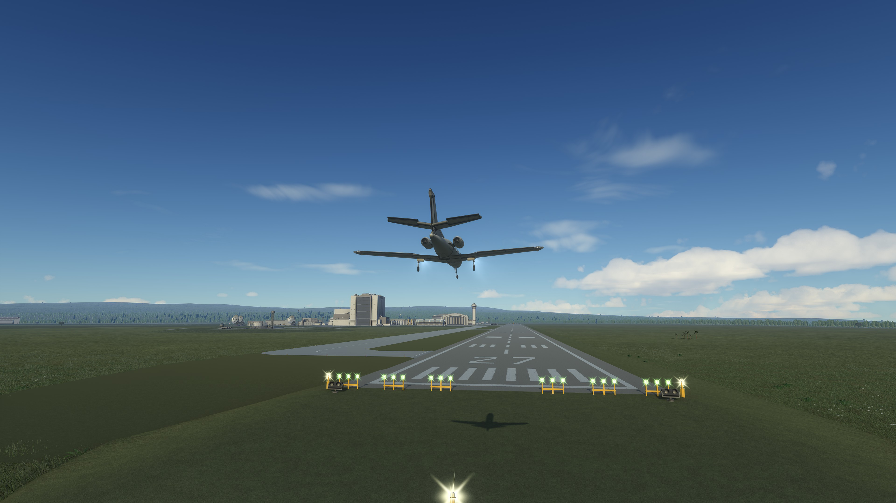

**Approach Autopilot** (formerly AtmosphereApproach) adds an **APR** (ILS approach) mode to [AtmosphereAutopilot](https://github.com/Boris-Barboris/AtmosphereAutopilot): arm it, and when you meet the runway centerline it captures the localizer and the glideslope and flies the approach down to the decision height, where it hands the aircraft back to you for the landing. Runways and glideslopes come from [NavInstruments](https://github.com/linuxgurugamer/NavInstruments).

New to it? Start with the **[Flight Manual](Flight-Manual)**: one complete approach to KSC runway 27, step by step.

Download, requirements and installation: see the [repository](https://github.com/Rjoande/ApproachAutopilot). Questions and feedback: [forum thread](https://forum.kerbalspaceprogram.com/topic/231869-1125-approach-autopilot-landing-controller-for-atmosphereautopilot/).